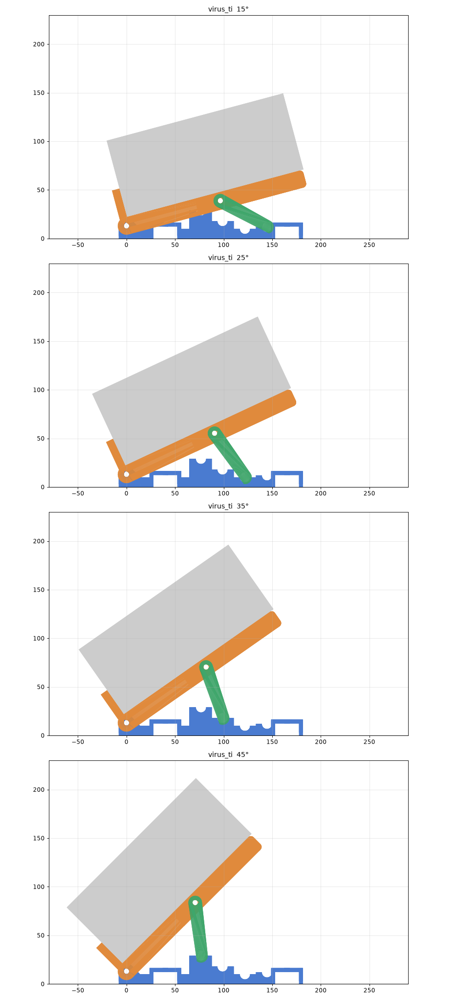

# Supporti inclinabili low profile

Un solo generatore (`stand.py`) per tre strumenti. Tutti hanno la stessa struttura a sdraio, ma con la **cerniera a pochi millimetri dal tavolo**:

- 2 fianchi, ognuno fatto di **base** con tacche a gradini, **ripiano** incernierato con bordino anteriore e **asta** che ruota in una forcella sul retro del ripiano;
- 2 traverse (una al centro, una dietro) che passano in tunnel nelle pareti della base e si fissano con una vite nell'aletta interna; le asole regolano la distanza tra i fianchi.

Davanti non c'è nessun blocco: la cerniera ha tutto lo spazio per ruotare.

| Cartella | Strumento | Angoli | Piano d'appoggio davanti | Profondità base | Filamento |
|---|---|---|---|---|---|
| `virus_ti/` | Access Virus TI/TI2 Desktop, 470 × 188 × 81 mm, 3,5 kg | 15° 25° 35° 45° | **22 mm** (bordino +30) | **190 mm** | ~460 g |
| `tracker_plus/` | Polyend Tracker+, 282 × 207 × 33 mm, 1,2 kg | 5° 10° 15° | **18 mm** (bordino +10) | 228 mm | ~255 g |
| `launchpad_pro/` | Novation Launchpad Pro MK3, 268 × 268 × 18 mm, ~1 kg | 5° 10° 15° | **18 mm** (bordino +8) | 228 mm | ~255 g |

Per confronto, nella prima versione (`../virus_stand/`) il piano d'appoggio era a 66 mm.
In ogni configurazione ho verificato che non ci siano collisioni tra base, ripiano, asta, traverse, teste delle viti e strumento (booleane 3D), e che ogni pezzo sia un corpo unico.
A 45° il bordo anteriore-alto del Virus sporge ~60 mm davanti alla base (in aria): è normale, la base resta entro i 190 mm.



## Pezzi (`<strumento>/stl/`, già orientati per la stampa, senza supporti)

| | Virus TI | Tracker+ / Launchpad |
|---|---|---|
| `base_x2` | 190 × 72 × 29 | 228 × 72 × 18 |
| `deck_x2` (ripiano) | 199 × 27 × 34 | 197 × 27 × 22–24 |
| `prop_x2` (asta) | 69 × 41 × 14 | 47 × 40 × 12 |
| traverse | `crossbar_A_x2` + `crossbar_B_x2` (244 mm, unite a mezzo legno) | `crossbar_x2` (248 mm, in un pezzo) |

Le traverse sono lunghe 244–248 mm: nel piatto da 256 della A1 entrano di poco; se lo slicer si lamenta, ruotale in diagonale.
Stampa consigliata: PETG, 4 pareti, gyroid 30–40 %.

## Ferramenta

**Virus TI**

- 2 viti M5×55 per la cerniera
- 2 viti M5×40 per il perno dell'asta
- 4 dadi autobloccanti M5 e 8 rondelle
- 4 viti M5×25, 4 dadi e 4 rondelle per fissare le traverse (nell'aletta interna delle basi)
- 6 viti M5×16 e 6 dadi per la giunzione delle traverse (3 per traversa)

**Tracker+ e Launchpad Pro (per ciascuno)**

- 2 viti M5×55 per la cerniera
- 2 viti M5×35 per il perno dell'asta
- 4 dadi autobloccanti M5 e 8 rondelle
- 4 viti M5×20, 4 dadi e 4 rondelle per le traverse (nell'aletta interna delle basi)

## Montaggio

1. **Traverse.** Sul Virus, unisci le metà A e B nella zona a mezzo legno: i dadi vanno nelle sedi esagonali sotto A, le teste delle viti nelle lamature sopra B.
2. **Basi.** Infila le due traverse nei tunnel delle basi (quello al centro e quello dietro). Le alette con il foro rivolte verso l'interno ricevono la vite: dado nel canale sotto la traversa, vite con rondella dall'alto. Le asole regolano la distanza tra i fianchi:
   - Virus: 330–390 mm, consigliata ~370;
   - Tracker+: 170–200 mm, consigliata ~190;
   - Launchpad Pro: 160–200 mm, consigliata ~180.
3. **Ripiano.** Infilalo tra le pareti della base, davanti, e fissalo con la vite della cerniera, le rondelle e il dado autobloccante.
4. **Asta.** Inseriscila nella forcella sul retro del ripiano e fissala con il perno. Le "orecchie" del piede si appoggiano nelle tacche delle pareti.
5. **Cambio angolo.** Solleva il retro dello strumento, sposta il piede nella tacca voluta e riabbassa. Le tacche sono a gradini: la più bassa e più indietro è l'angolo minimo, la più alta e più avanti è il massimo.

## Rigenerare / modificare

I parametri di ogni strumento stanno in `PROFILES` dentro `stand.py`. Gli helper geometrici sono in `cadlib.py`.

```
python stand.py                 # tutti i profili (o: python stand.py virus_ti)
python render.py                # anteprime in <strumento>/preview/
```
